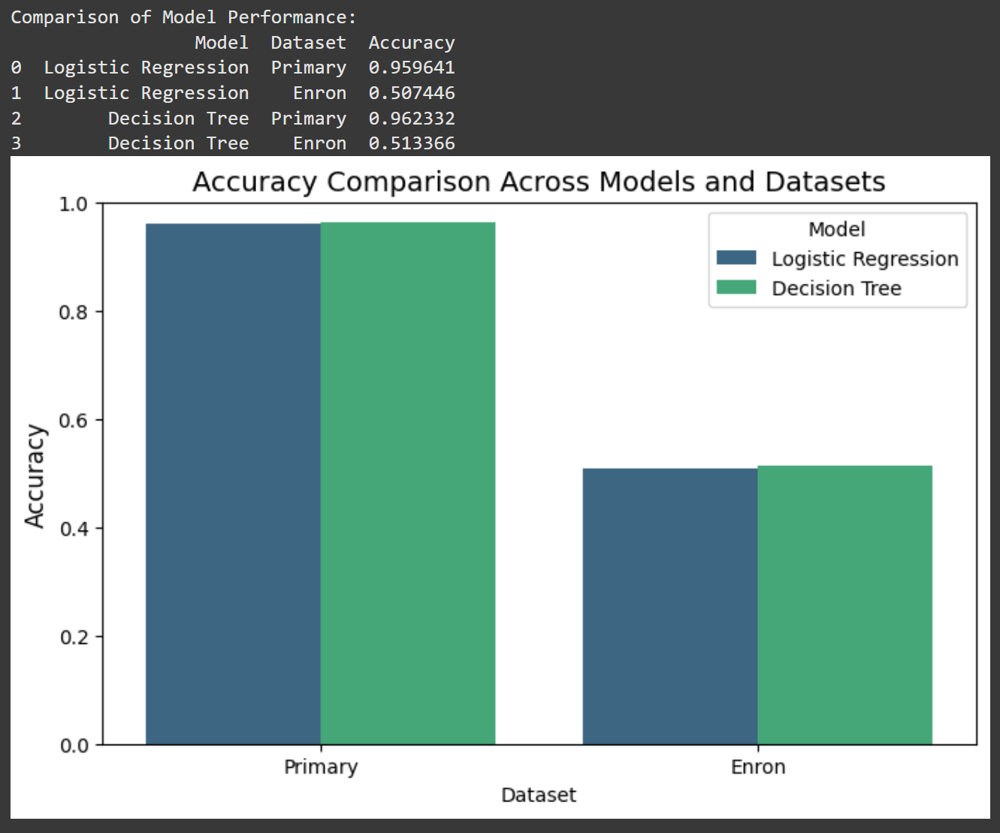

# Spam Detection with TF-IDF and Decision Trees

A notebook-driven machine learning project for classifying spam vs. ham text using TF-IDF feature extraction and decision tree modeling. The repository explores the classic SMS spam detection problem and also compares model behavior on a second dataset (Enron spam data) to evaluate robustness and transferability.

## Why this project exists

Spam filtering is a highly practical text classification task: the goal is to automatically identify unsolicited or malicious messages while preserving legitimate content. This project demonstrates a complete workflow for building a spam detector using classical NLP and machine learning techniques:

- clean and normalize raw text
- transform text into numeric features using TF-IDF
- train and evaluate classification models
- compare multiple models and datasets
- visualize performance and error patterns

This is a research/analysis project rather than a packaged application, so the main value is in the notebook-based experimentation and the documentation that explains the approach.

## Project goals

- build a spam detection model using TF-IDF and decision trees
- compare performance against a logistic regression baseline
- assess cross-dataset generalization between SMS and Enron data
- understand class imbalance and text preprocessing effects
- present results clearly through evaluation metrics and visualizations

## Dataset overview

### 1. SMS Spam Collection

This is the primary dataset used in the project and is included in the repository at:

- `data/SMSSpamCollection.csv`

It contains SMS messages labeled as either:

- `ham` (legitimate message)
- `spam` (unsolicited message)

Observed distribution from the notebooks:

- total messages: 5,572
- ham: 4,825
- spam: 747
- spam rate: about 13.4%

### 2. Enron spam dataset

The repository also analyzes the Enron spam corpus to test how well a model trained on one dataset transfers to another. The notebook loads this dataset from a local Google Drive path, and the project instructions show that it is used for cross-dataset evaluation experiments.

Observed distribution from the notebook output:

- total messages: 33,716
- spam: 17,171
- ham: 16,545

## Methodology

The project follows a standard text-classification pipeline:

1. Load the raw text dataset
2. Clean the text (lowercasing, punctuation removal, stop-word filtering)
3. Tokenize the text
4. Convert text to TF-IDF vectors
5. Split the data into training and testing sets
6. Train classification models
7. Measure accuracy, precision, recall, and F1-score
8. Compare results across datasets and models

The main models explored are:

- Logistic Regression as a baseline
- Decision Tree Classifier with hyperparameter tuning

The notebooks also evaluate the decision tree using a grid search over parameters such as:

- `max_depth`
- `min_samples_split`

## Repository structure

```text
spam-detection-tfidf/
├── README.md
├── requirements.txt
├── .gitignore
├── data/
│   └── SMSSpamCollection.csv
├── docs/
│   └── Spam_Detection_Paper.md
├── images/
│   ├── accuracy_comparison.png
│   ├── confusion_matrix_enron.png
│   ├── Effect_of_Tree_Depth_on_Accuracy.png
│   ├── ...
│   └── readme.md
├── notebooks/
│   ├── spam_detection_enron_and_SMSSpamCollection_analysis.ipynb
│   ├── text_classification_tfidf.ipynb
│   └── The_Final_Version_before_our_presentation_for_spam_detection_enron_and_SMSSpamCollection_datasets_analysis.ipynb
└── LICENSE (if added in a fork)
```

## Getting started

### 1. Clone the repository

```bash
git clone https://github.com/saberfazliahmadi/spam-detection-tfidf.git
cd spam-detection-tfidf
```

### 2. Create and activate a virtual environment

```bash
python -m venv .venv
source .venv/bin/activate
# On Windows:
# .venv\Scripts\activate
```

### 3. Install dependencies

```bash
pip install -r requirements.txt
```

### 4. Open the notebooks

```bash
jupyter notebook notebooks/
```

Then run the notebook cells in order to reproduce the experiments.

## Requirements

The project depends on these Python libraries:

- pandas
- numpy
- scikit-learn
- matplotlib
- nltk

You can find the pinned dependency list in `requirements.txt`.

## Visual results and model analysis

The following figures show the core observations from the project. They highlight class balance, message length patterns, model accuracy, and classification errors.

### Class distribution

The class distribution plot shows how imbalanced the SMS dataset is, with ham messages dominating the dataset and spam forming a smaller minority.

- SMS Spam Collection dataset


- Enron dataset


### Text length distribution

These plots compare message length distributions across datasets and help explain why a model trained on one domain may behave differently on another.

- SMS Spam Collection text length distribution


- Enron text length distribution


### Accuracy comparison across models and datasets

This chart compares the accuracy of Logistic Regression and Decision Tree models on the SMS and Enron datasets.



### Confusion matrices

Confusion matrices show how often the model correctly or incorrectly classifies spam and ham messages.

- Logistic Regression on SMS Spam Collection


- Logistic Regression on Enron dataset


- Decision Tree on SMS Spam Collection


- Decision Tree on Enron dataset


### Effect of decision tree depth on accuracy

The depth analysis shows how increasing the maximum tree depth influences model performance and when accuracy starts to plateau or degrade.

- Tree depth from 1 to 20

%20on%20Accuracy.jpg)

- Tree depth from 1 to 100

%20on%20Accuracy.jpg)

## Key results from the project

The notebook output includes the following model performance summaries.

### Primary SMS dataset

| Model | Accuracy |
| --- | ---: |
| Logistic Regression | 95.96% |
| Decision Tree | 96.23% |

### Enron dataset

| Model | Accuracy |
| --- | ---: |
| Logistic Regression | 50.74% |
| Decision Tree | 51.34% |

### Cross-dataset generalization

The notebook also tests a cross-dataset setting by training on Enron and testing on the primary SMS dataset:

- Cross-dataset accuracy: 34.10%

This result suggests the model does not generalize well across datasets without additional tuning or more robust feature engineering. In other words, the SMS dataset and the Enron dataset differ enough in language patterns and distribution that a simple TF-IDF model struggles to transfer cleanly across them.

## Evaluation metrics used

The project evaluates classification quality using:

- accuracy
- precision
- recall
- F1-score
- confusion matrix
- class distribution plots
- text-length analysis

These metrics are generated directly in the analysis notebook and visualized in the `images/` folder.

## Interpretation of the results

The project’s findings are consistent with a common pattern in spam detection:

- the model performs very well on the SMS dataset because the text is short, structured, and strongly correlated with typical spam patterns
- performance drops significantly on the Enron corpus because email content is more varied and noisier
- decision trees can perform competitively with logistic regression on the primary dataset, but cross-domain generalization remains difficult

This makes the project a good educational example of both the strengths and limitations of classical machine learning for text classification.

## Important project notes

- This repository is mainly a research and analysis project, not a production-ready API or web application.
- The notebook assumes some datasets may be loaded from local paths or mounted cloud storage.
- The project emphasizes reproducible experimentation and model comparison rather than deployment.

## Key files

- `data/SMSSpamCollection.csv` — main SMS spam dataset
- `notebooks/text_classification_tfidf.ipynb` — focused TF-IDF and decision tree analysis
- `notebooks/spam_detection_enron_and_SMSSpamCollection_analysis.ipynb` — broader comparison across datasets
- `docs/Spam_Detection_Paper.md` — write-up describing the problem, methodology, and results
- `images/` — charts and model diagnostics generated during the analysis

## Why this is a useful project

This repository is a good learning resource for:

- text preprocessing in NLP
- TF-IDF feature engineering
- classical machine learning for classification
- training/evaluation workflows in Python
- comparing model performance across datasets
- communicating results through notebooks and plots

## Future improvements

Possible next steps include:

- trying Random Forest, SVM, and XGBoost models
- tuning decision tree depth and other hyperparameters more systematically
- improving preprocessing and feature extraction
- experimenting with embeddings such as Word2Vec, GloVe, or BERT
- testing on larger and more diverse spam corpora

## Contributing

Contributions are welcome. If you improve the notebook, add a better model comparison, or improve the documentation, feel free to open a pull request.

## Acknowledgements

This project uses public spam datasets and standard scientific Python libraries to illustrate a practical text classification workflow.
